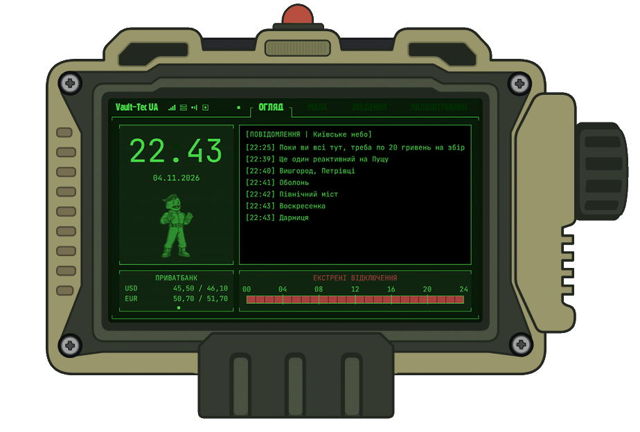
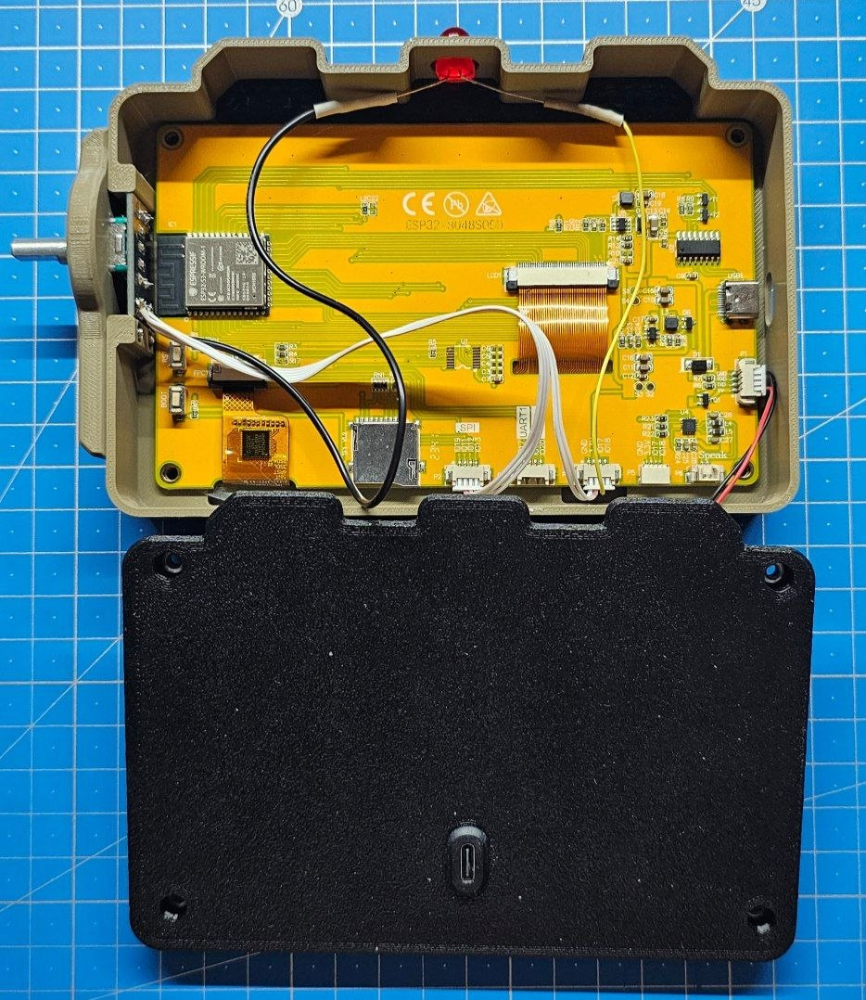
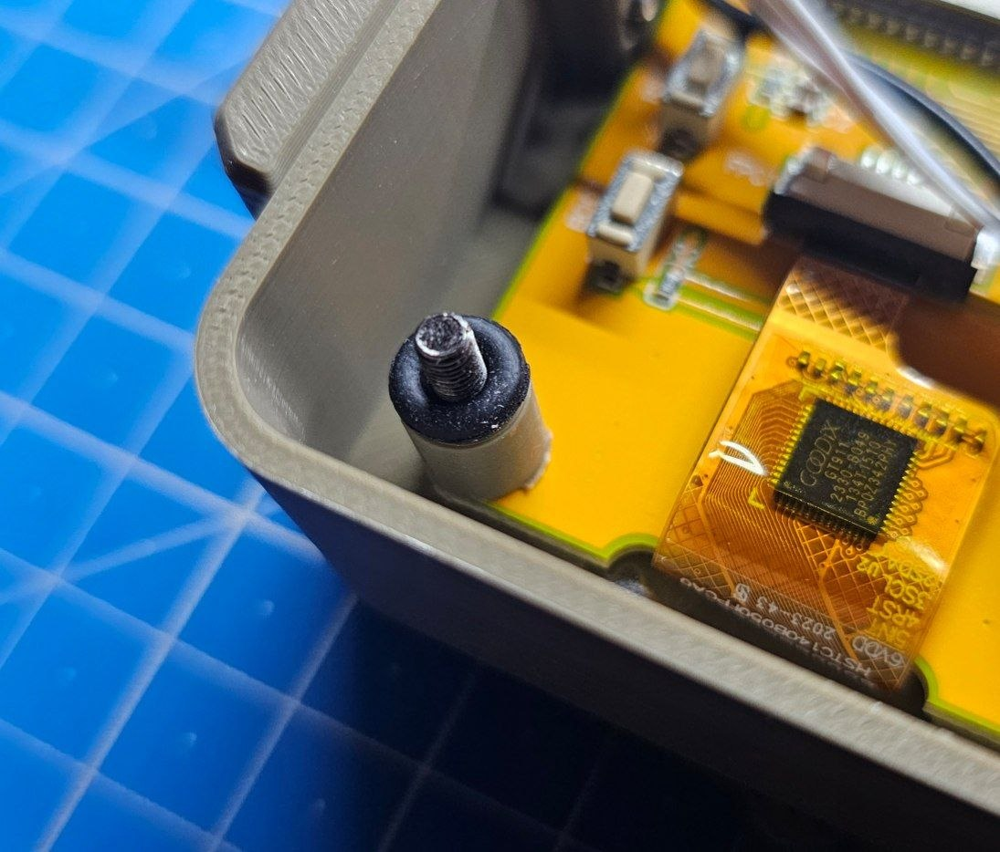

# RobCo Field Terminal MkII



> [!NOTE]
>
> * **Походження проєкту:** Спочатку «термінал» задумувався як настільний пристрій із базовим функціоналом - мінімалістичний елемент, іграшка для робочого столу, створений із доступних компонентів. Проєкт розроблявся виключно для особистого використання й орієнтувався на власні потреби.
> * **Доступність сервера:** Серверна частина проєкту фінансується за рахунок особистих коштів. Я забезпечуватиму її роботу якомога довше, наскільки це буде можливо. Проте за нинішніх обставин **гарантії стабільної роботи та постійної доступності сервера не надаються**.
> * **Точність даних і можливі збої:** Система інтегрує сторонні API та зовнішні джерела, отримання інформації з яких у деяких випадках реалізовано за допомогою нестандартних технічних рішень. Через це можливі затримки, тимчасова недоступність окремих функцій або помилки, що не залежать від мене. **Я не несу відповідальності за актуальність, точність і своєчасність відображуваної інформації.**
> * **Зворотний зв'язок:** Повідомлення про помилки, конструктивні пропозиції та ідеї щодо вдосконалення проєкту завжди вітаються.

---

## 1. Необхідні компоненти

### Електроніка

* Налагоджувальна плата **ESP32-8048S050C** із сенсорним екраном діагоналлю 5 дюймів та роздільною здатністю 800×480.  
  ([Замовляв тут](https://www.aliexpress.com/item/1005006625220768.html))
* Модуль енкодера **KY-040 (EC11 із різьбою)** — стандартний модуль із п'ятьма контактами: CLK, DT, SW, + та GND.  
  ([Приклад використовуваного модуля](https://arduino.ua/ru/prod1223-modyl-enkoder))
* Роз'єм **USB Type-C «мама»**.  
  ([Приклад використовуваного роз'єму](https://www.aliexpress.com/item/1005006099544502.html))
* Червоний світлодіод діаметром 8 мм для індикації повітряної тривоги.
* Резистор **330 Ом**.
* З'єднувальні дроти та конектори.
* USB-кабель для підключення плати до комп'ютера (постачається в комплекті з платою).

### Кріплення та деталі корпусу

* Гвинти M3×24 мм із гайками — 4 шт.
* Гвинти M2×8 мм із гайками — 2 шт.
* Гумові кільця або прокладки — 4 шт.
* Деталі корпусу, надруковані на 3D-принтері з пластику PETG.

### Програмне забезпечення та драйвери

* [Драйвер USB-SERIAL CH340](https://www.wch-ic.com/downloads/CH341SER_EXE.html)
* [esptool v5.4.0](https://github.com/espressif/esptool/releases/download/v5.4.0/esptool-v5.4.0-windows-amd64.zip)

### Додатково

* Трохи суперклею.

---

## 2. Перше прошивання

### 2.1. Підготовка

1. Встановіть драйвер **CH340** та перезавантажте комп'ютер.
2. Створіть у корені диска, наприклад `C:\`, окрему папку для прошивання. Для прикладу використовуватимемо:

   ```text
   C:\esptool
   ```
3. Розпакуйте завантажений архів **esptool** у створену папку.
4. [Завантажте готову прошивку](https://github.com/RobCoMeerkat/Field-Terminal-Mk.II/releases/download/v1.6.0/RobCoFieldTerminal_MkII_V1.6.0_FULL_FACTORY_16MB.bin) та помістіть файл `.bin` у ту саму папку, поруч із `esptool.exe`.
5. Підключіть плату до комп'ютера через **USB-порт безпосередньо на самій платі**.

---

### 2.2. Визначення COM-порту

1. Відкрийте командний рядок Windows:

   * натисніть **Win + R**;
   * введіть `cmd`;
   * натисніть **Enter**.

2. Перейдіть до папки, у якій знаходяться `esptool.exe` та файл прошивки:

   ```cmd
   cd C:\esptool
   ```

   Якщо ви використовували інше розташування папки, вкажіть відповідний шлях.

3. Виконайте команду:

   ```cmd
   esptool flash-id
   ```

4. Дочекайтеся появи інформації про виявлений пристрій. Знайдіть рядок такого вигляду:

   ```text
   Connected to ESP32-S3 on COM9
   ```

   У моєму випадку пристрій визначився на порту **COM9**.

   **Запам'ятайте номер COM-порту.** Надалі замість `COM9` необхідно використовувати порт, який визначився саме на вашому комп'ютері.

---

### 2.3. Очищення пам'яті

Перед першим прошиванням рекомендується повністю видалити заводську прошивку та вміст пам'яті пристрою.

Виконайте команду, замінивши `COM9` на номер свого COM-порту:

```cmd
esptool --chip esp32s3 --port COM9 erase-flash
```

Дочекайтеся завершення операції.

Якщо операцію виконано успішно, наприкінці має з'явитися результат приблизно такого вигляду:

```text
Flash memory erased successfully in XX seconds.
```

---

### 2.4. Прошивання пристрою

Після очищення пам'яті можна записати нову прошивку.

Виконайте команду, замінивши:

* `COM9` — на COM-порт вашого пристрою;
* `RobCoFieldTerminal_MkII_V1.6.0_FULL_FACTORY_16MB.bin` — на фактичну назву файлу прошивки, якщо вона відрізняється.

```cmd
esptool --chip esp32s3 --port COM9 --baud 230400 write-flash 0x0 RobCoFieldTerminal_MkII_V1.6.0_FULL_FACTORY_16MB.bin
```

Дочекайтеся повного завершення процесу.

Якщо прошивання пройшло успішно, пристрій запуститься автоматично.

---

## 3. Первинне налаштування

Після запуску дочекайтеся появи **QR-коду на екрані термінала**.

1. Відскануйте QR-код телефоном.

2. Підключіться до мережі Wi-Fi, яку створює термінал.

3. Відкрийте у браузері адресу:

   ```text
   192.168.4.1
   ```

4. Відкриється вебпанель термінала (необхідно зачекати — завантаження може тривати досить довго).

5. Виконайте первинне налаштування пристрою.

6. Тепер можна від'єднати пристрій від комп'ютера та переходити до збирання.

---

## 4. Збирання

### 4.1. Підключення світлодіода:

```
IO17 → резистор 330 Ом → анод LED
GND  → катод LED
```

### 4.2. Підключення енкодера:

```
CLK → IO11
DT  → IO12
SW  → IO13
+   → 3.3V
GND → GND
```

### 4.3. Підключення заднього USB-порту:

```
+ (червоний) → 5V
GND (чорний) → GND
```

#### Приклад кустарного підключення:



### 4.4. Фінальне збирання

> [!NOTE]
> Корпус може мати незначні похибки друку (допуски підбиралися з урахуванням особливостей друку на моєму принтері), проте збирання не потребує особливих зусиль і не має критичних складнощів.

#### 1. Підготовка корпусу та встановлення закладних кріплень

1. **Приклеювання деталей:** За допомогою суперклею приклейте рамку світлодіода та решітку.
2. **Встановлення гайок:**
   * Встановіть гайки **М3** у задню кришку.
   * Встановіть гайки **М2** у бічну стінку (для кріплення панелі енкодера).

#### 2. Монтаж елементів керування та роз'ємів

1. **Бічна панель:** Прикрутіть панель гвинтами **М2**.
2. **Роз'єм USB:** Встановіть USB-роз'єм у посадкове місце та підключіть його.
3. **Енкодер:** Вставте енкодер у бічну панель і затягніть комплектною гайкою.
4. **Світлодіод:** Вставте світлодіод зсередини у верхню рамку до упору. Отвір зроблено трохи меншим за діаметр світлодіода, тому він входить із натягом і не потребує додаткової фіксації.

#### 3. Встановлення екрана та стягування корпусу

1. З фронтального боку корпусу встановіть рамку екрана та пропустіть крізь неї довгі гвинти **М3×24**.
2. Переверніть корпус і встановіть плату з екраном на місце.
3. Надягніть на гвинти **втулки** та **демпферні гумові кільця** (їх можна замінити будь-яким м'яким матеріалом), щоб забезпечити безпечне та рівномірне притискання плати.



4. Накрийте корпус задньою кришкою та затягніть гвинти з фронтального боку, рівномірно стягуючи всі частини конструкції.
5. Надягніть ковпачок на вал енкодера.
6. Встановіть зібраний пристрій на підставку.

Тепер пристрій можна підключати до комп'ютера або павербанка та використовувати.

Додатковий USB-порт спеціально винесено на задню кришку, щоб можна було акуратно прокласти кабель живлення.
